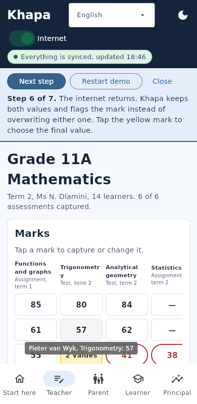

# Khapa (Flet rebuild)

An offline-first school app for South Africa, rebuilt in **Python and Flet** for the FNB App of the Year Hackathon.
One teacher, one parent, one learner and one principal share the same picture of a learner's progress, even when the school has no internet.
This is a faithful port of the browser prototype: same four roles, same sync rules, same fictional content, same risk thresholds, same seven-step guided demo.

**Every name, mark and comment in this app is made up. There are no real learners, no accounts and no network calls.**



## Run it (about a minute)

You need **Python 3.12**. Then, from this folder:

| | Windows (PowerShell) | macOS / Linux |
|---|---|---|
| Desktop window | `.\run_demo.ps1` | `./run_demo.sh` |
| Phone-sized window | `.\run_demo.ps1 -Phone` | `./run_demo.sh phone` |
| In a browser (`http://localhost:8550`) | `.\run_demo.ps1 -Web` | `./run_demo.sh web` |

The script creates a virtual environment, installs the pinned `flet[all]==1.0.5`, and starts the app.
By hand: `python -m venv .venv`, activate it, `pip install -r requirements.txt`, `flet run src/main.py`.

Then tap **Play the guided demo** on the first screen. To build an Android APK, follow **[BUILD_APK.md](BUILD_APK.md)** (on your PC) or **[docs/BUILD_WITH_GITHUB_ACTIONS.md](docs/BUILD_WITH_GITHUB_ACTIONS.md)** (in the cloud, no local toolchain). Neither route has been run by the author.

**For judges with remote access:** the app has no logins. Either run the line above, or use a build from the organisers' side.
By design, each browser session of `flet run --web` gets its own private in-memory world, so several judges can use one host at once (multi-session behaviour was not load-tested).

## The guided demo (seven steps, same copy as the prototype)

1. The internet drops. The teacher keeps working because the school hub is local.
2. The teacher captures a mark offline. It saves on the hub and shows a yellow "waiting to upload" dot.
3. The parent's phone shows what it last saved, and **says so** in a banner. The new mark is not there yet.
4. The internet returns. The hub uploads, the phone downloads, and the projection updates.
5. Two people change the **same** mark while apart: the teacher on the hub, the HOD on a tablet whose clock is four minutes wrong.
6. The internet returns. Khapa **keeps both values and flags the mark**. It never silently overwrites either.
7. The teacher taps the yellow mark, chooses the final value, and every device converges.

Open **Show devices and security** at the bottom of any screen to watch the four simulated devices, their clocks and state fingerprints.

## What is real and what is simulated

| Part | Status |
|---|---|
| Sync engine: hybrid logical clocks, per-field last-writer-wins for learner profiles, append-only marks, conflict flags, idempotent replay, convergence in any order | **Real.** Pure Python, standard library only. 57 engine tests plus randomised convergence tests. |
| Rule-based analytics: seven-point CAPS-style scale, weak topics, trend projection, three-tier risk flag with a one-sentence reason | **Real.** Checked against the prototype's own JavaScript output for every learner and for the whole demo (see below). |
| Four devices (school hub, HOD tablet, cloud, phone) and the internet switch | **Simulated.** All four run inside this app. No sockets are opened. |
| Learners, marks, comments, the school-wide table | **Fictional**, copied from the prototype. |
| Suggestions ("what to teach", "how to help") | **Fixed rule-based text, English only.** No AI model runs anywhere in this app. |
| Translations | Only **English is complete**. Afrikaans and isiZulu are **partial drafts awaiting human review**. The other eight official languages show English with a visible "Not translated yet" notice. Nothing is machine-translated. |
| Audit log, role checks, canary record | **Real code, demo scope.** See "Security" below. |
| Local storage | **Real.** One SQLite file per installed app (see "Storage"). |
| Sign-in, the real school hub, SA-SAMS import, privacy review, a pilot school | **Not built.** |

The AI-suggestion disclosure ("These suggestions are generated automatically. Your teacher makes the final decision.") appears on every screen that shows analytics-driven suggestions.
The wording is slightly different from the Phase-0 backend's draft because this port keeps the prototype's text.

## How it is built

```
src/
  main.py                 entry point (flet run / flet build)
  khapa_core/             pure Python, standard library ONLY, no Flet import
    hlc.py                hybrid logical clock, strict timestamp parsing
    validation.py         manual validators (no Pydantic)
    events.py             immutable, SHA-256 content-hashed events
    engine.py             SyncNode: per-field LWW, append-only marks, conflict flags, sync_pair
    analytics.py          levels, weak topics, projection, risk flag
    security.py           hash-chained audit log, role guard, canary record
    store.py              SQLite persistence (stdlib sqlite3)
    session.py            all application behaviour; the UI is a thin layer over this
    demo.py / world.py    the 7 demo steps; the four simulated devices
    data.py               fictional content, GENERATED from the prototype by tools/gen_data.py
    i18n.py / suggest.py  honest translation fallback; the Suggester interface
  khapa_ui/               Flet presentation only
    app.py                builds the control tree once, updates only the region that changed
    views.py              role screens as pure builders
    widgets.py / theme.py reusable controls; palette ported from the prototype
tests/                    381 tests (pytest)
tools/                    generators and dev helpers (not shipped in the APK)
```

**Why standard library only.** The earlier backend ADR chose a browser PWA because Flet struggles to package libraries with native extensions (SQLAlchemy, Pydantic).
For this hackathon track the goal is Flet, so the engine uses `dataclasses`, manual validation functions and plain dicts, with no third-party packages.
That keeps the app packageable for Android, iOS and desktop. The only dependency is Flet.

**Flet, not DOM diffing.** The prototype rebuilt `innerHTML` on every change. Here the control tree is built once. `Session` announces which *scope* changed
(`chrome`, `body`, `demo`, `devices`) and the app updates only that region. Wide tables live in persistent scrolling rows so a sync never snaps the teacher
back to the first column. Timers run through Flet's own task runner so updates keep their page context.

More detail, trade-offs and every deliberate difference from the prototype: **[docs/DESIGN.md](docs/DESIGN.md)**.

## Security (demo scope, stated honestly)

There is no network and there are no accounts, so these controls demonstrate the *design* a production hub would need. They are not a security audit,
and nothing here claims ISO/IEC 27001 certification.

- **Validated input everywhere.** Unknown fields, non-finite numbers, booleans-as-numbers, control characters, oversize text, malformed clocks and self-referencing marks are rejected.
- **Tamper-evident events.** Every sync event carries a SHA-256 digest of its content. A changed event, or a known event id replayed with different content, is rejected.
  This detects corruption and tampering in transit or storage. It does **not** prove who sent an event: that needs signatures and key management.
- **Hash-chained audit log.** Saves, conflicts, refused actions and snooping attempts are logged. Editing any entry breaks the chain. (Truncating the end of the log is not detectable by a chain alone.)
- **Role checks.** Only a teacher can write marks or comments. A parent can only open their own child. Refusals are audited.
- **Canary record.** A decoy learner is stored and synced like real data but listed nowhere. Any attempt to open it raises an alert in the audit log.
  Try it in **Show devices and security**. It is plainly labelled because this is a demo; a real hub would generate plausible decoys per school.
- **Log-injection and SQL-injection safe.** Control characters are stripped from log text; every SQL statement uses bound parameters.
- **Clock-poisoning guard.** A remote timestamp absurdly far in the future is rejected so it cannot drag a device's clock forward for good.

## Storage

- **Android / iOS / desktop:** one private SQLite file (`khapa.db`) in the app's data folder (`FLET_APP_STORAGE_DATA`, or `~/.khapa-demo` for desktop runs).
  The event log is saved, and replayed (digests re-checked) on the next start. **Reset demo data** wipes it. Language choice is kept.
- **Browser (`flet run --web`):** memory only, one world per browser session, so judges never see each other's changes.
- If the database is unreadable, tampered with, or from a different schema version, the app starts fresh and writes a `STORAGE_RESET` entry to the audit log instead of crashing.
- If saving fails (full or read-only disk), the app keeps working in memory and tells you.
- Set `KHAPA_PERSIST=0` to disable persistence.

## Tests

```
pip install -r requirements-dev.txt
pytest -q          # 381 tests, a few seconds
```

| File | What it covers |
|---|---|
| `test_engine.py` (57) | Idempotency, convergence in any order, per-field LWW, conflict flagging, slow-clock correctness, rejection rules, digest tampering, randomised multi-node convergence |
| `test_analytics_parity.py` (243) | Ported analytics tests, **plus exact parity with the prototype's JavaScript** for 207 level boundaries, every learner's risk flag and reasons, edge series, and the state of all four devices at every demo step |
| `test_security.py` (12) | Audit chain tamper detection, log injection, canary, role policy |
| `test_session_demo.py` (37) | The seven demo steps end to end, parsing of marks like `38,5`, persistence, restart mid-conflict, tampered database, schema mismatch, unwritable storage, SQL-injection text |
| `test_i18n_purity.py` (5) | 11 languages registered, no fabricated translations, visible notices, and a check that `khapa_core` imports only the standard library |
| `test_ui.py` (27) | Real Flet 1.0.5 control trees for every role in every demo state, required copy (AI note, stale banner, not-translated notice), targeted updates, dialogs, handler errors |

The parity fixtures were produced by running the prototype's own `engine.js`, `analytics.js` and `world.js` (`tools/gen_golden.js`).
As a check that the tests can fail, five deliberate bugs were injected into the engine and analytics (never flagging conflicts, ignoring clocks, changing a risk threshold, and so on), and the suite caught every one.

## Verified, and not verified

See **[docs/VERIFICATION.md](docs/VERIFICATION.md)** for the evidence and the commands to reproduce it. In short:

- **Verified:** the test suite; the real **Flet 1.0.5 desktop client** (Flutter 3.44.8) running every screen, the dialogs, saving a mark, and all seven demo steps, at phone size under a virtual display (screenshots in `docs/screenshots/`); `flet run --web` serves the app (HTTP 200).
- **Not verified:** an Android APK build or install (no Android/Flutter toolchain or Google download access in the author's sandbox), iOS, a physical phone, a real browser session over the web, Windows and macOS desktop windows, and TalkBack or other accessibility tooling.
  `BUILD_APK.md` is written from Flet 1.0.5's own build source and says so.

## Optional stretch: an offline language model

Not built, on purpose. The demo comes first, and the rule-based flags are what make every flag explainable in one sentence.
There is a `Suggester` interface in `khapa_core/suggest.py` where a model could plug in. The plan, the trade-offs and the guard rails (disclosure always visible, model never decides a flag) are in `docs/DESIGN.md`.

## Licence and data

The fictional content comes from the Khapa web prototype. Add your own licence before publishing the repository.
